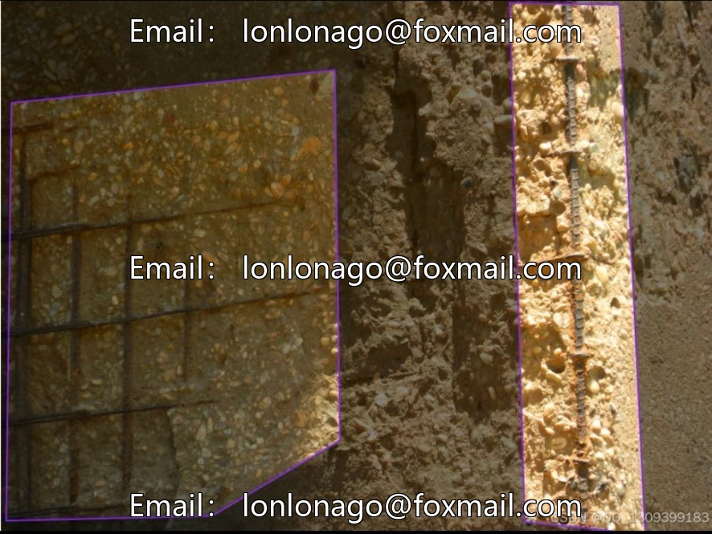
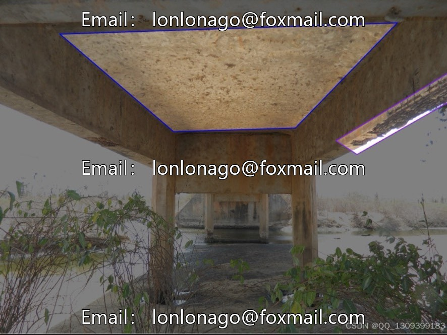
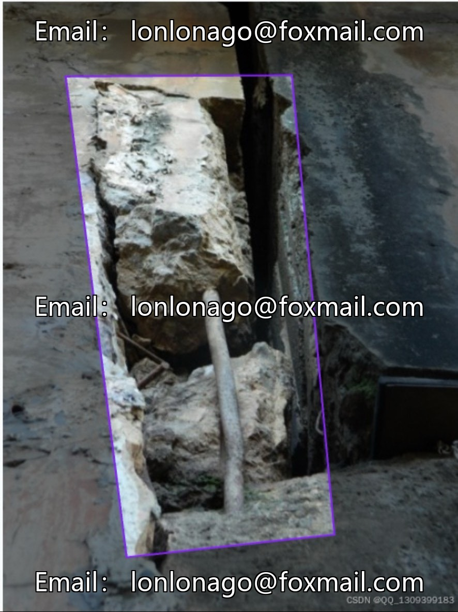
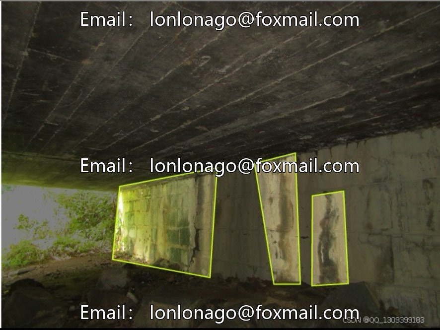
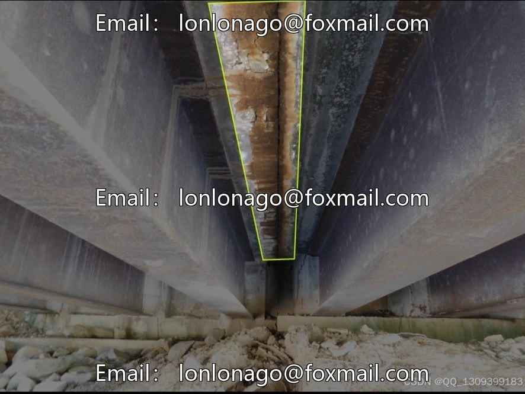

# UAV Bridge Defects and Disease Dataset, Issue 10010, Targeted for Bridge Disease Inspection

## Body

UAV Bridge Defects and Diseases Dataset, Issue 10010, specifically designed for bridge disease target detection, compatible with UAV intelligent inspection and health monitoring scenarios. Complimentary pre-trained model, ready to use right out of the box.

Data Content
- Total number of images: 2136 actual photos of bridge deterioration
- Annotation method: Full-volume OBB (Object Boxes), precisely selecting tilted and irregularly damaged areas, recognizing minor damages at the millimeter level.
- Supporting model: yolonas-s pretrained model with YOLOv5, supports direct deployment for testing.

Annotation Category (Total of 8 Common Concrete Diseases)
- Biodegradation, concrete dissolution, cracking, scaling, exposed rebar, template defects, stain penetration, unspecified items
- Sample Characteristics: High prevalence of frequent diseases such as cracking and scaling, with fewer severe diseases like exposed rebar; covers various bridge types, day and night conditions, and weather environments, with a rich variety of shooting angles.

Officially, the proportions and precise resolution of various categories are not disclosed. It is estimated that the original image resolution ranges from 1280×720 to 4096×2160. Before training, dimensional normalization will be conducted.

Usage Recommendation: It is recommended to conduct data exploration first. For rare diseases such as exposed reinforcement bars, data augmentation can be used to expand the sample size, thereby enhancing the model's detection performance.

Virtual materials, once sold, are non-refundable.
Interested friends, click "I want" to proceed.

## Images

## Payment

Here is a pay link on Stripe ( https://buy.stripe.com/3cs8yP7sY87d0vu9AB ). Please contact me lonlonago@foxmail.com after funding $89, and I will send you a complete data files , thank you!

